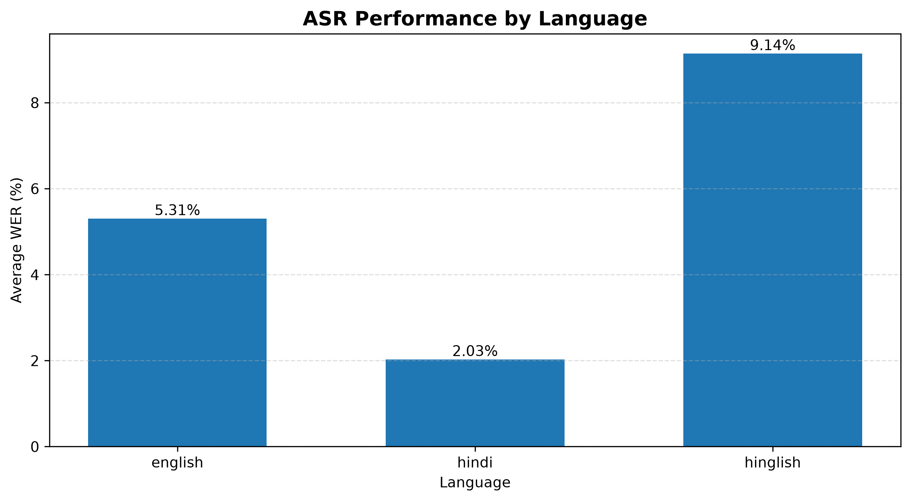
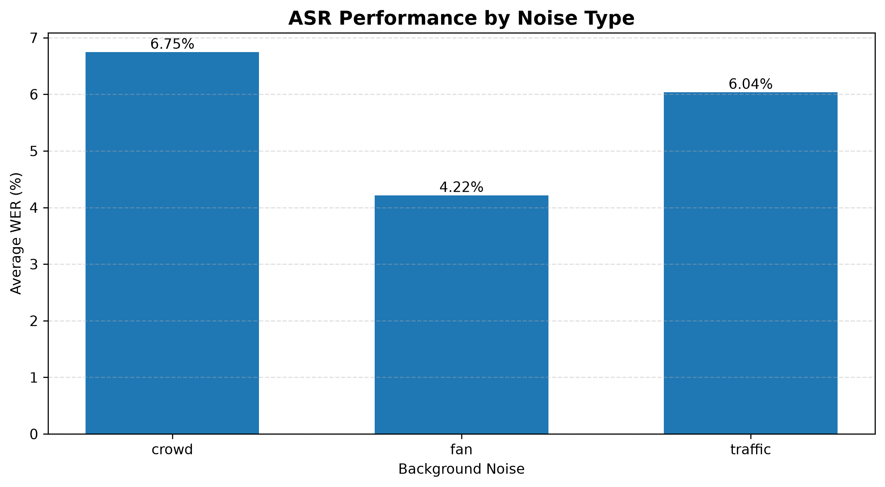
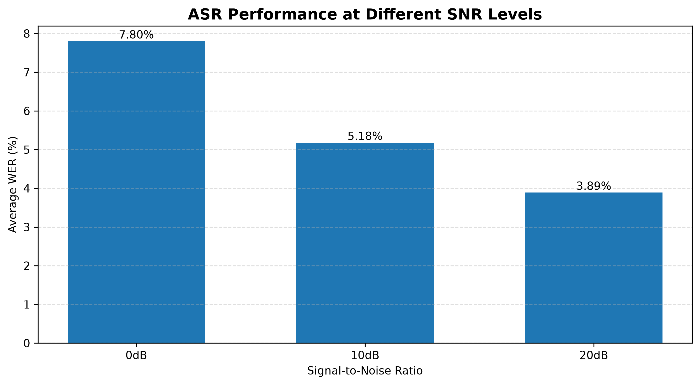
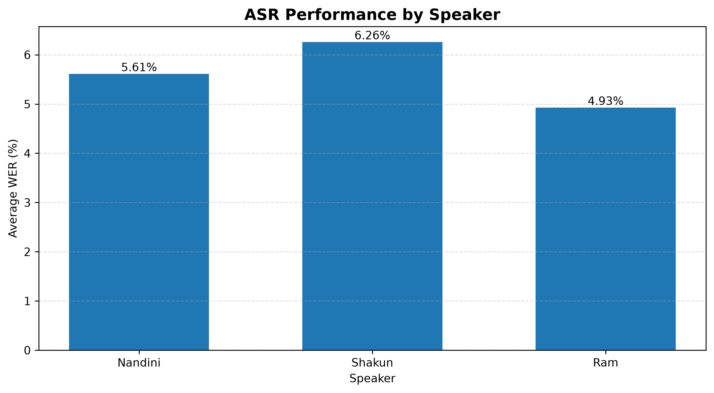

 <div align="center">

# 🇮🇳 BharatVoice Bench

### Evaluating Multilingual Speech Recognition Under Controlled Background Noise

**An evaluation framework for Gnani Prisma v2.5 across English, Hindi, and Hinglish.**
**Live Demo:** https://bharatvoice-bench.onrender.com

**Source Code:** https://github.com/niniwritescode/BharatVoice-Bench

**Video Demo:** https://youtu.be/YbLFRq7ov_k
[](https://www.python.org/)
[](https://flask.palletsprojects.com/)
[]()
[]()

[**GitHub Repository**](https://github.com/niniwritescode/BharatVoice-Bench)

</div>

---

## 1. Project Overview

BharatVoice Bench is a speech recognition evaluation framework developed to examine how reliably Gnani Prisma v2.5 transcribes spoken content across different languages, speakers, and background-noise conditions.

The project evaluates three language categories:

- English
- Hindi
- Hinglish

It uses clean speech recordings and controlled noisy versions generated with crowd, fan, and traffic noise at different signal-to-noise ratios (SNRs).

The resulting transcriptions are evaluated using Word Error Rate (WER), supported by error analysis and a Flask-based dashboard for exploring the results.

**Research question:**

How reliably does Gnani Prisma v2.5 preserve spoken content across English, Hindi, and Hinglish when exposed to different speakers and controlled background noise?

## 2. Experiment at a Glance

| Evaluation dimension | Coverage |
|---|---:|
| Languages | 3 |
| Speakers | 3 |
| Clean recordings | 9 |
| Generated noisy recordings | 81 |
| Successful noisy transcriptions | 78 |
| Failed API requests | 3 |
| Noise conditions | Crowd, Fan, Traffic |
| SNR levels | 0 dB, 10 dB, 20 dB |

The three failed requests returned HTTP 403 responses. They were Hindi recordings associated with speaker Ram and were excluded from WER calculations. Their exact noise-condition filenames have not been independently verified, so no specific noise category is attributed to these failures.

## 3. Evaluation Results

### 3.1 Clean recordings

The clean-recording corpus WER results were:

| Language | Corpus WER |
|---|---:|
| English | 3.60% |
| Hindi | 6.31% |
| Hinglish | 9.38% |

### 3.2 Noisy recordings

The following results are from the 78 successfully transcribed noisy recordings, using the normalized scoring pipeline.

**Language-wise WER**

| Language | Corpus WER |
|---|---:|
| English | 5.31% |
| Hindi | 2.03% |
| Hinglish | 9.14% |

**Noise-wise WER**

| Noise condition | Corpus WER |
|---|---:|
| Crowd | 6.64% |
| Fan | 4.09% |
| Traffic | 5.77% |

**SNR-wise WER**

| SNR | Corpus WER |
|---|---:|
| 0 dB | 7.74% |
| 10 dB | 4.91% |
| 20 dB | 3.71% |

**Speaker-wise WER**

| Anonymized speaker | Corpus WER |
|---|---:|
| Speaker 1 | 5.45% |
| Speaker 2 | 4.74% |
| Speaker 3 | 6.08% |

**Overall normalized noisy-corpus WER: 5.45%.**

The strict, non-normalized noisy-corpus WER was 37.48%. The mean of individual recording-level WER values was 5.63%. These are different measurements: corpus WER aggregates word errors across the complete corpus, while the mean recording-level WER gives each recording equal weight.

### Important interpretation note

The clean and noisy scoring scripts currently use different normalization rules. Therefore, the clean and noisy language-wise WER values should not be treated as a directly comparable measurement until both datasets are rescored using the same normalization pipeline.

In particular, the lower noisy Hindi WER does not establish that background noise improved Hindi recognition. The clean Hindi corpus contains only three recordings, whereas the noisy Hindi results contain 24 successful recordings. The scoring-rule difference and sample-size difference both affect this comparison.

The subgroup results are pilot-study observations, not statistically conclusive claims about general speech recognition performance.

## 4. Normalization and WER Calculation

Word Error Rate measures the difference between a reference transcript and a recognized transcript.

$$
\mathrm{WER} = \frac{S+D+I}{N}\times 100
$$

Where:

- **S** = Substitutions
- **D** = Deletions
- **I** = Insertions
- **N** = Number of words in the reference transcript

Two scoring views were examined:

1. **Strict WER:** Evaluates text with minimal normalization.
2. **Normalized WER:** Applies text normalization to account for selected formatting and number-expression variations.

Examples of normalization targets include:

| Text variation | Canonical representation |
|---|---|
| twelve thousand five hundred fifty | 12550 |
| twenty five | 25 |
| ten thirty | 1030 |
| Numeric and currency formatting variations | Standardized numeric text |

These examples illustrate the types of variation considered; they are not an exhaustive list of normalization rules.

The noisy corpus produced 37.48% strict WER and 5.45% normalized WER. This substantial difference shows that normalization has a major effect on the measured score.

**Normalization limitation:** The clean scoring script contains inline normalization rules, while the noisy scoring script uses shared normalization functions from `normalization.py`. The rule sets are not identical. The exact point at which the normalization rules were finalized relative to output inspection has not been documented. Consequently, the normalized clean and noisy results require a common scoring pipeline before direct comparison.

## 5. Error Analysis

Across the 78 successfully transcribed noisy recordings, the normalized evaluation counted:

| Error type | Count |
|---|---:|
| Substitutions | 79 |
| Deletions | 34 |
| Insertions | 37 |
| **Total errors** | **150** |

### Language-level observations

| Language | Substitutions | Deletions | Insertions |
|---|---:|---:|---:|
| English | 15 | 29 | 8 |
| Hindi | 14 | 4 | 0 |
| Hinglish | 50 | 1 | 29 |
| **Total** | **79** | **34** | **37** |

Hinglish contributed the largest number of substitutions and insertions in this dataset. This suggests that mixed-language speech and language-switching deserve closer investigation.

English accounted for most deletions, while Hindi had fewer counted errors in the normalized noisy results.

These observations describe this particular pilot corpus. They should not be interpreted as universal rankings of language recognition performance.

## 6. Failed API Requests and Data Handling

Three noisy transcription requests returned HTTP 403 responses with Cloudflare block pages. All three were Hindi recordings from Speaker 3 under crowd-noise conditions at 0 dB, 10 dB, and 20 dB SNR. These were infrastructure-level request failures, not ASR transcription errors, and were excluded from WER scoring. The remaining 78 noisy recordings were successfully evaluated.

The failed requests were associated with:

- **Speaker:** Speaker 3 (anonymized)
- **Language:** Hindi
- **Noise condition:** Crowd noise
- **SNR levels:** 0 dB, 10 dB, and 20 dB
- **Count:** 3 requests
- **Response:** HTTP 403 (Cloudflare access block)

These failures were treated as API/request failures, not transcription errors. They were excluded from WER calculations because no usable transcription was returned. The responses contained Cloudflare block pages rather than ASR outputs.

Because of these failures, the successful recording counts are uneven:

| **Dimension** | **Successful recordings** |
|---|---|
| Language | English: 27, Hindi: 24, Hinglish: 27 |
| Noise | Crowd: 24, Fan: 27, Traffic: 27 |
| SNR | 26 recordings at each level |
| Speaker | 27, 24, and 27 recordings |

This imbalance should be considered when interpreting subgroup comparisons.

## 7. Dashboard

BharatVoice Bench includes a Flask dashboard for exploring the evaluation results.

The dashboard provides:

- Overall evaluation metrics
- Language-wise WER comparisons
- Noise-condition comparisons
- SNR-level comparisons
- Speaker-wise comparisons
- Recording-level evaluation information

### Dashboard visualizations

**WER by language**



**WER by noise condition**



**WER by signal-to-noise ratio**



**WER by speaker**



## 8. Experiment Workflow

The evaluation workflow consists of the following stages:

1. Prepare clean speech recordings in English, Hindi, and Hinglish.
2. Generate controlled noisy versions using crowd, fan, and traffic noise.
3. Prepare recordings at 0 dB, 10 dB, and 20 dB SNR.
4. Submit the recordings to Gnani Prisma v2.5 through its speech-to-text API.
5. Collect successful transcription responses.
6. Compare recognized text with the corresponding reference transcripts.
7. Calculate strict and normalized WER.
8. Analyze substitutions, deletions, insertions, and subgroup patterns.
9. Export anonymized numerical results for the dashboard.

## 9. Technology Stack

| Component | Technology |
|---|---|
| Speech recognition | Gnani Prisma v2.5 |
| API integration | Python, Requests |
| Backend | Python, Flask |
| Frontend | HTML, CSS, JavaScript |
| Audio preparation | FFmpeg |
| Evaluation metric | Word Error Rate |
| Scoring library | JiWER |
| Data analysis | Python, Pandas |
| Visualizations | Matplotlib |
| Version control | Git and GitHub |

## 10. Run the Dashboard Locally

### Prerequisites

- Python 3.x
- Git
- pip

### Step 1: Clone the repository

```bash
git clone https://github.com/niniwritescode/BharatVoice-Bench.git
cd BharatVoice-Bench
```

### Step 2: Create a virtual environment

**Windows Command Prompt:**

```cmd
python -m venv venv
venv\Scripts\activate
```

**macOS / Linux:**

```bash
python3 -m venv venv
source venv/bin/activate
```

### Step 3: Install dependencies

```bash
pip install -r requirements.txt
```

### Step 4: Start the application

```bash
python app.py
```

Open the following address in your browser:

```text
http://127.0.0.1:5000
```

The dashboard uses the anonymized dataset stored in `public_data/`. Running the dashboard does not require an API key or access to private research recordings.

## 11. Repository Structure

```text
BharatVoice-Bench/
│
├── app.py
├── main.py
├── normalization.py
├── score.py
├── score_noise.py
├── error_analysis.py
├── inspect_errors.py
├── make_graphs.py
├── mix_audio.py
├── prepare_noise.py
├── check_failed.py
├── export_public_data.py
│
├── public_data/
│   └── noisy_wer_summary.csv
│
├── static/
│   ├── css/
│   ├── js/
│   └── graphs/
│
├── templates/
│
├── requirements.txt
├── PROJECT_STATUS.md
├── .gitignore
└── README.md
```

Private working directories such as `data/`, `references/`, and `results/` are intentionally excluded from the public repository.

## 12. Privacy and Responsible Sharing

The public repository contains the evaluation framework and an anonymized numerical dataset.

The following materials are intentionally excluded:

- Original audio recordings
- Personal reference sentences and transcripts
- Raw ASR transcription outputs
- Private intermediate result files
- API keys and credentials
- `.env` configuration files

Speaker labels and recording identifiers in the public dataset are anonymized.

The repository is intended to share the evaluation workflow and selected numerical findings without exposing private recordings or credentials.

## 13. Limitations and Future Improvements

This project has several limitations:

- The pilot evaluation uses only three speakers.
- Accent and speaker diversity are limited.
- Three API requests failed with HTTP 403 and were excluded from scoring.
- The successful subgroup counts are not perfectly balanced.
- Clean and noisy scoring currently use different normalization rule sets.
- WER measures word-level transcription differences, not semantic understanding.
- Normalized WER depends on the text normalization rules applied.
- The observed differences between noise conditions are based on a small evaluation corpus.

Future improvements could include:

- Rescoring all clean and noisy recordings with one shared normalization pipeline.
- Expanding the speaker and accent sample.
- Repeating experiments across additional recordings.
- Investigating language-switching and number-recognition errors in Hinglish.
- Verifying failed API requests against their original request logs.
- Extending the dashboard with additional error-analysis views.

## 14. Project Context and Authorship

**BharatVoice Bench** was independently developed by **Nandini** as a solo project for the **Great Indian AI Internship Challenge**.

**Gnani technology evaluated:** Gnani Prisma v2.5 Speech-to-Text.

The project is an evaluation framework and analysis workflow; it is not a newly trained speech recognition model.

---

<div align="center">

**BharatVoice Bench**

*Evaluating multilingual speech recognition across languages and controlled noise conditions.*

[GitHub Repository](https://github.com/niniwritescode/BharatVoice-Bench)

</div>
